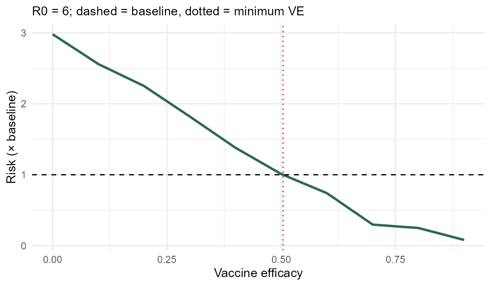

# Get started with quarantineRisk

**Who this is for:** public health students and policy analysts.
**Question:** for a variant with a given transmissibility (R₀), how much
vaccine efficacy (VE) is needed to keep border-quarantine breach risk at
or below an acceptable level, compared with the pre-Delta baseline?

## Installation

``` r
# install.packages("devtools")
devtools::install_github("ETC5523-2026/etc5523-assignment-4-yfan0161-stack")
```

``` r
library(quarantineRisk)
library(ggplot2)
```

## The data

`quarantine_risk` holds model results adapted from Zachreson et
al. (2022) for R₀ from 1 to 10 and VE from 0 to 0.9.

``` r
head(quarantine_risk)
#> # A tibble: 6 × 3
#>      R0    VE beta_ratio
#>   <int> <dbl>      <dbl>
#> 1     1   0       0.163 
#> 2     1   0.1     0.143 
#> 3     1   0.2     0.132 
#> 4     1   0.3     0.127 
#> 5     1   0.4     0.0972
#> 6     1   0.5     0.0607
```

### Key terms

Before using the app, here are the terms it relies on:

| Term | In plain language | Example |
|----|----|----|
| R₀ | The average number of people one infected person passes the virus to. | R₀ = 3: one case infects about 3 others. R₀ = 6: about 6. The higher it is, the harder it is to keep quarantine leak-free. |
| VE (vaccine efficacy) | How strongly vaccination protects (0 = no protection, 0.9 = 90% protection). | VE = 0.6 means 60% protection. |
| Baseline | The benchmark risk that quarantine was designed around: the original virus with no vaccination. In this dataset it equals R₀ = 3 and VE = 0. | Baseline = 1×. |
| Breach | An infection that escapes quarantine into the community. | A traveller infected in quarantine who leaves still infectious. |
| Risk (× baseline) | A score comparing a scenario with the baseline: 1 = the same, 2 = twice as much, 0.5 = half. It is not a probability. | R₀ = 10 and VE = 0.1 gives 6.8× baseline. |
| Acceptable risk | The highest risk you are willing to tolerate, as a multiple of the baseline. | 1 = no worse than baseline; 2 = up to twice as much. |

### Columns in `quarantine_risk`

| Column | What it holds | Example value |
|----|----|----|
| `R0` | Basic reproduction number (1 to 10) | `6` |
| `VE` | Vaccine efficacy (0 to 0.9) | `0.5` |
| `beta_ratio` | Risk relative to the baseline: total infection force divided by the baseline’s | `1.01` (about the same as baseline) |

### Model assumptions

- The values come from a computer simulation of a quarantine system that
  follows WHO recommendations and quarantines all international arrivals
  (Zachreson et al., 2022).
- They describe one modelled system. Real quarantine facilities, testing
  and traveller behaviour differ.
- Values are relative to the baseline, not the chance of a breach.

### How much do the inputs matter?

As R₀ rises, the vaccine efficacy needed to match the baseline climbs
quickly: about 0.5 at R₀ = 6 and about 0.73 at R₀ = 10.

## Calculate risk for one scenario

``` r
calculate_risk(r0 = 6, ve = 0.6)
#> [1] 0.74
calculate_risk(r0 = 6, ve = 0.5)
#> [1] 1.01
calculate_risk(r0 = 6, ve = 0.3)
#> [1] 1.82
```

Values below 1 are better than the baseline; values above 1 mean
elevated breach risk. Values between grid points are linearly
interpolated.

## Find the vaccine efficacy needed

``` r
find_threshold_ve(r0 = 6, target = 1)
#> [1] 0.504
find_threshold_ve(r0 = 6, target = 0.5)
#> [1] 0.654
```

At R₀ = 6, VE must reach about 0.5 to keep risk at or below the
baseline. If the target cannot be met even at VE = 0.9, the function
returns `NA`:

``` r
find_threshold_ve(r0 = 10, target = 0.1)
#> [1] NA
```

``` r
ve <- seq(0, 0.9, by = 0.01)
d <- data.frame(VE = ve, risk = calculate_risk(6, ve))
ggplot(d, aes(VE, risk)) +
  geom_line(colour = "#2d6a4f", linewidth = 1) +
  geom_hline(yintercept = 1, linetype = "dashed") +
  geom_vline(xintercept = find_threshold_ve(6), linetype = "dotted", colour = "#c1121f") +
  labs(x = "Vaccine efficacy", y = "Risk (× baseline)",
       subtitle = "R0 = 6; dashed = baseline, dotted = minimum VE") +
  theme_minimal()
```



## Launch the Shiny app

``` r
run_app()
```

**Controls**

- *R₀ slider*: transmissibility of the variant.
- *VE slider*: vaccine efficacy in the population.
- *Acceptable risk*: your tolerance as a multiple of the baseline (must
  be greater than 0; otherwise the app shows a message).

**Outputs and how to read them**

- The *risk card* compares the modelled risk at your R₀ and VE with your
  target (green = below, amber = about equal, red = above).
- The *minimum VE card* gives the lowest VE that reaches your target at
  that R₀. This directly answers the app’s question.
- In the *heatmap*, dark green is low risk and yellow/red is high; the
  corners are labelled “Lower risk” and “Higher risk”. The dashed line
  marks your target: combinations above and to the left of it (high VE,
  low R₀) meet the target; those below and to the right exceed it. The
  white dot is your selection.
- The *line plot* is a slice of the heatmap at your R₀ (green line). The
  grey lines show R₀ = 3, 6 and 10 for comparison, and the dotted red
  line shows the minimum VE. Where the green curve crosses the dashed
  line is the same point as on the heatmap.

If you enter an acceptable risk that is empty, zero or negative, the app
asks you to correct it. If the target cannot be met at any modelled VE,
the app says so and suggests a higher tolerance or a lower R₀.

## Limitations

- Results are relative risks from published simulations of low-tolerance
  quarantine systems, not probabilities of a breach.
- The data is a 10 × 10 grid with linear interpolation between points.
  The simulation output contains some noise, which is why the dashed
  line on the heatmap has small steps.
- The model describes one idealised quarantine system; real-world
  quarantine differs.
- The package is for exploring scenarios and teaching, not for
  operational decisions.
